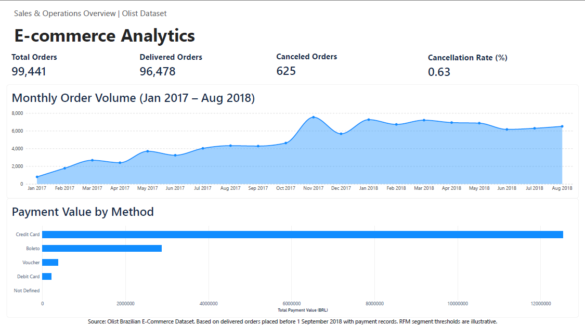
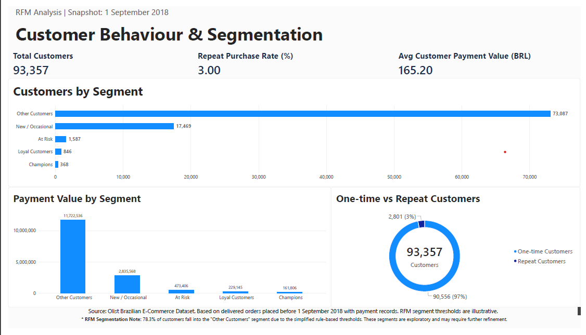

# Olist E-commerce Analytics | SQL, Power BI & Python

**An end-to-end analytics portfolio exploring e-commerce operations, payment behaviour and customer segmentation, with a Python extension for data validation and automated reporting.**

## 1. Project Overview

This project analyses the Brazilian E-Commerce Public Dataset by Olist to investigate operational performance, recorded payment values, customer purchasing behaviour and RFM customer segmentation.

The workflow combines MySQL analysis, Power BI dashboards and Python reporting automation. It covers data validation, KPI calculation, visualisation and the communication of findings and limitations.

### Project Objectives

- Evaluate order volume, delivery status and cancellation performance.
- Analyse payment methods and recorded payment values.
- Investigate customer purchasing frequency and repeat-purchase behaviour.
- Develop rule-based customer segments using Recency, Frequency and Monetary metrics.
- Communicate findings through interactive dashboards.
- Automate consistency checks, monthly comparisons and English report generation.

### Reporting Automation Extension

The Python extension reuses six SQL-generated CSV outputs to validate key metrics, calculate monthly changes and generate traceable HTML reports.

The working offline version uses **rule-based interpretation**. An optional AI interpretation interface is implemented, but live API testing remains pending. The reporting workflow was developed with AI coding assistance.

[View reporting automation documentation](reporting_automation/README.md)

## 2. Tools & Technical Skills

| Tool / Skill | Application |
|---|---|
| MySQL 8.0 | Data validation, filtering, aggregation, JOINs, subqueries and CTEs |
| Advanced SQL | Window functions, ranking, running totals and month-on-month growth |
| Power BI Desktop | KPI reporting, interactive dashboards and business data visualisation |
| Python | CSV validation, monthly comparisons, traceable findings and automated HTML reporting |
| Customer Analytics | Repeat-purchase analysis, RFM metrics and rule-based segmentation |
| Business Analytics | KPI definition, trend interpretation, data quality assessment and recommendations |

The Python reporting workflow uses the standard library and requires no additional Python packages.

## 3. Business Questions

The project addresses five core questions:

1. How did monthly order volumes and cancellation rates change over time?
2. Which payment methods contributed the highest recorded payment value?
3. What proportion of customers placed repeat orders during the observation period?
4. How can customers be grouped using Recency, Frequency and Monetary metrics?
5. How can existing analytical outputs be checked and converted into consistent, readable operational reports?

## 4. Data Source & Scope

**Dataset:** Brazilian E-Commerce Public Dataset by Olist  
**Data Provider:** Olist  
**Platform:** Kaggle  
**License:** CC BY-NC-SA 4.0

[View the original dataset](https://www.kaggle.com/datasets/olistbr/brazilian-ecommerce)

The dataset contains approximately 100,000 historical e-commerce orders placed in Brazil between 2016 and 2018.

This project uses three primary source tables:

| Source Table | Description |
|---|---|
| `olist_orders_dataset` | Order identifiers, order status and purchase timestamps |
| `olist_customers_dataset` | Customer identifiers and geographical information |
| `olist_order_payments_dataset` | Payment methods, payment amounts and payment records |

### Reporting Scope

Different analyses use different populations and reporting periods.

| Analysis | Reporting Scope |
|---|---|
| Overall operational KPIs | All records in the Orders dataset |
| Monthly order performance | January 2017–August 2018 |
| Payment method analysis | All available records in the Payments dataset |
| Customer behaviour and RFM | Delivered orders purchased before 1 September 2018, with matching customer and payment records |
| Automated monthly report | Selected month within the monthly reporting window, compared with the immediately preceding month where available |
| Customer findings in automated reports | Fixed customer snapshot dated 1 September 2018 |

Orders are grouped by purchase month. Their recorded statuses are not historical month-end status snapshots.

The original source files are not included in this repository. They can be downloaded from Kaggle.

The six CSV files in `dashboard_data/` are SQL-generated reporting outputs, rather than copies of the complete original source tables. They support both the Power BI dashboards and the Python reporting extension.

## 5. Analytical Workflow

The project follows six stages.

### Stage 1 — Data Validation

Validated record counts, unique identifiers, missing values and relationships between the Orders, Customers and Payments datasets.

### Stage 2 — Operational Analysis

Calculated order-level KPIs, evaluated cancellation rates and analysed monthly order trends using SQL aggregation and window functions.

### Stage 3 — Payment Analysis

Aggregated payment records by `order_id` before calculating order-level payment values, avoiding inflated counts and values from one-to-many joins.

Payment methods were also analysed separately using the recorded payment data.

### Stage 4 — Customer Behaviour & RFM Segmentation

Used `customer_unique_id` to calculate purchasing frequency, monetary value and recency for eligible customers, followed by rule-based segmentation.

### Stage 5 — Dashboard Development

Prepared six aggregated CSV outputs from MySQL and developed a two-page Power BI dashboard covering operational performance and customer behaviour.

### Stage 6 — Reporting Automation

Extended the SQL-generated CSV outputs with a Python workflow that validates data consistency, calculates monthly changes and generates English HTML reports.

The working offline version uses predefined interpretation rules. An optional AI interpretation interface awaits live API testing.

## 6. Dashboard 1 — Sales & Operations Overview



### Key Performance Indicators

| Metric | Result |
|---|---:|
| Total Orders | 99,441 |
| Delivered Orders | 96,478 |
| Canceled Orders | 625 |
| Cancellation Rate | 0.63% |

These KPIs use all records in the Orders dataset.

Cancellation rate is calculated as:

**Canceled Orders / Total Orders × 100**

Only orders with the status `canceled` are included in the numerator.

### Key Findings

**Monthly order volume**

Monthly order volume reached 7,544 in November 2017, the highest month within the January 2017–August 2018 reporting window.

This variation supports further investigation into purchasing patterns and operational capacity requirements. Order counts alone do not establish the causes of demand changes.

**Cancellation performance**

The overall cancellation rate was approximately 0.63%.

Monthly monitoring can identify periods requiring further investigation. A low overall rate does not imply consistent cancellation performance across individual months.

**Payment method distribution**

Credit cards accounted for the highest recorded payment value.

| Payment Method | Recorded Payment Value (BRL) |
|---|---:|
| Credit Card | 12,542,084.19 |
| Boleto | 2,869,361.27 |
| Voucher | 379,436.87 |
| Debit Card | 217,989.79 |
| Not Defined | 0.00 |

Recorded payment values should not be interpreted as platform net revenue or profit.

## 7. Dashboard 2 — Customer Behaviour & Segmentation



**Analysis Snapshot:** 1 September 2018

This dashboard analyses customers with delivered orders purchased before the snapshot date and matching customer and payment records.

### Customer KPIs

| Metric | Result |
|---|---:|
| Customers Analysed | 93,357 |
| One-time Customers | 90,556 |
| Repeat Customers | 2,801 |
| Repeat Purchase Rate | 3.00% |
| Average Customer Payment Value | BRL 165.20 |

A repeat customer is a `customer_unique_id` with at least two eligible orders.

Repeat-purchase rate is calculated as:

**Repeat Customers / Total Customers × 100**

This measures historical repeat purchasing within the available observation window. It is not cohort-based retention.

### RFM Methodology

| Metric | Definition |
|---|---|
| Recency (R) | Days between 1 September 2018 and the customer's latest eligible purchase |
| Frequency (F) | Number of distinct eligible orders placed by the customer |
| Monetary (M) | Total recorded payment value associated with eligible orders |

Payment records were aggregated at order level before customer-level calculations to avoid multiplying values.

### Customer Segmentation Rules

Five customer segments were created using predefined business rules.

| Customer Segment | Classification Rule |
|---|---|
| Champions | Recency ≤ 90 days, Frequency ≥ 2, Monetary ≥ BRL 200 |
| Loyal Customers | Recency ≤ 180 days, Frequency ≥ 2, excluding customers already classified as Champions |
| At Risk | Recency > 180 days, Frequency ≥ 2 |
| New / Occasional | Recency ≤ 90 days, Frequency = 1 |
| Other Customers | All remaining eligible customers |

Rules are applied in the stated order using SQL `CASE WHEN` logic.

### Segmentation Results

| Customer Segment | Customers | Share |
|---|---:|---:|
| Other Customers | 73,087 | 78.29% |
| New / Occasional | 17,469 | 18.71% |
| At Risk | 1,587 | 1.70% |
| Loyal Customers | 846 | 0.91% |
| Champions | 368 | 0.39% |
| **Total** | **93,357** | **100.00%** |

### Key Findings

**Limited observed repeat purchasing**

Approximately 3.00% of eligible customers placed at least two delivered orders during the observation period.

Further analysis is needed to understand purchasing cycles, repeat-purchase opportunities and the influence of the observation window.

**Limited differentiation within the largest segment**

Approximately 78.3% of customers were classified as Other Customers.

The simplified rules place most customers in the same category, limiting the usefulness of this segmentation for differentiated engagement. This does not establish that these customers are low-value.

**Opportunities for further analysis**

Percentile-based RFM scoring, cohort analysis and additional behavioural features could support more informative customer segmentation.

## 8. Business Recommendations

### Recommendation 1 — Investigate Repeat-Purchase Opportunities

Proposed next steps include:

- Compare customer cohorts using consistent observation windows.
- Examine the time between first and subsequent purchases.
- Investigate product categories associated with repeat orders if additional data is incorporated.
- Test targeted post-purchase engagement strategies where appropriate.

These steps were not implemented or experimentally evaluated in this project.

### Recommendation 2 — Investigate Operational Changes

Monthly order and cancellation trends can identify periods requiring closer review.

Further analysis could examine:

- Whether observed changes persist across months.
- Cancellation patterns during higher-volume periods.
- Delivery performance and fulfilment capacity.
- Regional or product-level differences, using additional data where needed.

The existing findings do not establish the causes of cancellations or operational bottlenecks.

### Recommendation 3 — Refine Customer Segmentation

Potential improvements include:

- Percentile-based RFM scoring.
- Analysis of recency and payment-value distributions within Other Customers.
- Additional customer behavioural variables.
- Evaluation of segment stability and future purchasing outcomes.

These improvements would need validation before being used for customer targeting.

## 9. SQL Methodology & Data Quality

### Data Validation

Checks included:

- Record counts and distinct identifiers.
- Duplicate identifiers.
- Missing values in key fields.
- Order status distributions.
- Purchase date coverage.
- Matching customer and payment records.
- Multiple payment records associated with the same order.

### JOINs and Data Granularity

The tables were connected using `customer_id` and `order_id`.

Because an order can have multiple payment records, payment amounts were aggregated before order-level and customer-level analysis.

```sql
WITH order_payments AS (
    SELECT
        order_id,
        SUM(payment_value) AS order_payment_value
    FROM olist_order_payments_dataset
    GROUP BY order_id
)
```

This produces one aggregated payment value per order, subject to the uniqueness of the other JOIN keys.

For payment-method analysis, an order may appear under more than one payment method. Method-level unique order counts should therefore not be summed as a total count of distinct orders.

### Customer Identification

`customer_id` identifies the customer record associated with an order.

`customer_unique_id` identifies a customer across multiple orders and is used for repeat-purchase analysis and RFM calculations.

### Time-Series Analysis

Monthly performance was analysed using `DATE_FORMAT()`, aggregation and the `LAG()` window function.

Month-on-month growth is calculated as:

**(Current Month Orders − Previous Month Orders) / Previous Month Orders × 100**

The first reporting month has no preceding month within the selected analysis window.

### Python Consistency Checks

The reporting extension adds checks for:

- Required files and columns.
- Empty fields and invalid numeric values.
- Duplicate months and categories.
- Cancellation rates against order counts.
- Repeat-purchase rates against customer counts.
- Customer totals across KPI, frequency and segment outputs.
- Average customer payment values against totals.

These checks identify inconsistencies between reporting outputs. They do not prove that every source record or SQL transformation is correct.

## 10. Project Structure

```text
Olist_Ecommerce_Analytics_Portfolio/
|
|-- README.md
|
|-- sql/
|   |-- 01_create_database.sql
|   |-- 02_data_validation.sql
|   |-- 03_basic_sql_queries.sql
|   |-- 04_business_kpi_analysis.sql
|   |-- 05_date_trend_analysis.sql
|   |-- 06_sql_joins.sql
|   |-- 07_revenue_payment_analysis.sql
|   |-- 08_subqueries_cte.sql
|   |-- 09_window_functions.sql
|   |-- 10_customer_rfm_segmentation.sql
|   |-- 11_dashboard_data.sql
|
|-- dashboard_data/
|   |-- executive_kpis.csv
|   |-- monthly_performance.csv
|   |-- payment_methods.csv
|   |-- customer_kpis.csv
|   |-- customer_segments.csv
|   |-- customer_frequency.csv
|
|-- dashboard/
|   |-- Olist_Ecommerce_Dashboard.pbix
|
|-- images/
|   |-- sales_overview.png
|   |-- customer_analytics.png
|
|-- reporting_automation/
    |-- .gitignore
    |-- README.md
    |-- report.py
    |-- test_report.py
    |-- Start.cmd
    |-- Run_Report.ps1
    |-- examples/
        |-- 2018-07.html
        |-- 2018-08.html
```

### SQL File Descriptions

| SQL File | Main Purpose |
|---|---|
| 01 — Create Database | Set up the MySQL database |
| 02 — Data Validation | Examine completeness, uniqueness and table relationships |
| 03 — Basic SQL Queries | Explore orders using filtering, sorting and conditional queries |
| 04 — Business KPI Analysis | Calculate operational KPIs and cancellation rates |
| 05 — Date & Trend Analysis | Analyse monthly order volume, growth and cancellations |
| 06 — SQL JOINs | Combine tables and examine data granularity |
| 07 — Payment Analysis | Analyse recorded payment values and payment-based AOV |
| 08 — Subqueries & CTEs | Perform multi-stage payment and regional analysis |
| 09 — Window Functions | Calculate rankings, running totals and monthly growth |
| 10 — Customer RFM Segmentation | Calculate customer metrics and rule-based segments |
| 11 — Dashboard Data Preparation | Generate six aggregated reporting datasets |

### Dashboard Data Files

| File | Main Use |
|---|---|
| `executive_kpis.csv` | Overall operational KPIs |
| `monthly_performance.csv` | Monthly order and cancellation trends |
| `payment_methods.csv` | Payment-method reporting |
| `customer_kpis.csv` | Customer totals and repeat-purchase metrics |
| `customer_segments.csv` | RFM segment counts and payment values |
| `customer_frequency.csv` | One-time versus repeat customer counts |

The Python extension reads these existing files directly. It does not require another copy of the data.

## 11. Reproducing the Analysis

### SQL and Power BI

1. Download the original dataset from Kaggle.
2. Install MySQL 8.0.
3. Run `sql/01_create_database.sql` to prepare the database.
4. Import the Orders, Customers and Payments CSV files using the expected table names.
5. Run the remaining SQL scripts in order.
6. Run `sql/11_dashboard_data.sql` and export its six results using the corresponding filenames in `dashboard_data/`.
7. Open `dashboard/Olist_Ecommerce_Dashboard.pbix` in Power BI Desktop.
8. Update CSV source paths if necessary, refresh the dashboard and review the results.

The scripts assume the source tables are available in the `ecommerce_analysis` database. CSV import and column-type configuration may be required.

### Python Reporting

The included aggregated CSV files allow the reporting extension to run without rebuilding the MySQL analysis.

Install Python 3.10 or later, then follow the instructions in Section 15.

## 12. Limitations

### Historical Observation Period

The data covers historical transactions from 2016–2018. Findings may not reflect current e-commerce behaviour.

### Different Reporting Scopes

Operational KPIs, monthly trends, payment methods and customer analysis use different populations and periods.

The automated report keeps these scopes separate. Its fixed customer snapshot may include transactions after an earlier selected operating month and must not be treated as information available at that earlier date.

### Recorded Order Status

Orders are grouped by purchase month, but their recorded statuses are not historical month-end snapshots. Monthly cancellation rates should be interpreted accordingly.

### Payment Value Interpretation

Recorded payment value does not necessarily equal recognised revenue, net revenue or profit.

The project does not model refunds, margins or complete platform financial performance.

### Repeat-Purchase Analysis

Repeat-purchase rate measures the proportion of eligible customers with at least two orders during the observation period. It is not cohort-based retention.

Customer acquisition dates and available follow-up time can affect this measure.

### RFM Segmentation

The thresholds are illustrative rather than statistically optimised or validated.

Approximately 78.3% of customers fall into Other Customers, limiting the segmentation's ability to differentiate behaviour.

### Reporting Automation

The current extension starts from existing CSV files. It does not automatically extract data from MySQL, refresh Power BI, schedule runs or distribute reports.

The offline interpretation uses predefined text. The optional AI interface has been tested with mocked responses, but live connectivity and output quality remain unvalidated.

### Business Recommendations

Recommendations are exploratory. No causal effects, business improvements or time savings have been established through implementation or controlled evaluation.

## 13. Data Attribution & Usage

The underlying dataset was created and released by Olist and made available through Kaggle.

**Source:** [Brazilian E-Commerce Public Dataset by Olist](https://www.kaggle.com/datasets/olistbr/brazilian-ecommerce)

**License:** [Creative Commons Attribution-NonCommercial-ShareAlike 4.0 International](https://creativecommons.org/licenses/by-nc-sa/4.0/)

This repository is intended as an educational, non-commercial analytics portfolio. The underlying data and derived reporting outputs remain subject to applicable licensing conditions.

The SQL analysis, dashboard design, reporting workflow and written interpretation are presented as portfolio work using this public dataset.

## 14. Project Summary

This project combines MySQL analysis, Power BI visualisation and Python reporting automation to investigate e-commerce operations and customer behaviour.

It demonstrates relational data analysis, consistent KPI definitions, rule-based customer segmentation and the communication of findings and limitations.

The Python extension reuses six aggregated CSV outputs to validate key metrics, calculate monthly changes and generate traceable English reports.

The reporting workflow was developed with AI coding assistance. Its current working version uses rule-based interpretation; live testing of the optional AI interpretation interface remains pending.

## 15. Python Reporting Automation

### Purpose

Reduce repetitive work involved in checking analytical outputs, comparing months and preparing a consistent operational report.

### Workflow

**SQL-generated CSVs → Python validation → calculated findings → interpretation → HTML report → human review**

Python performs the numerical calculations. In offline mode, predefined text explains the findings and suggests further investigation.

When explicitly enabled and configured, the optional AI interface sends aggregated facts and reporting definitions to an external model to produce interpretation drafts.

### Current Status

| Component | Status |
|---|---|
| CSV consistency checks | Implemented and tested |
| Monthly comparisons | Implemented and tested |
| English HTML reports | Implemented and tested |
| Rule-based interpretation | Working default; no AI call |
| Optional AI interpretation | Implemented; mocked API tests only, live testing pending |
| MySQL extraction and Power BI refresh | Not automated |
| Scheduling and report delivery | Not implemented |
| Time-saving and business-impact evaluation | Not yet completed |

### Run on Windows

1. Download and extract the full repository.
2. Install Python 3.10 or later if required.
3. Open the `reporting_automation` folder in Windows File Explorer.
4. Double-click `Start.cmd`.
5. Enter a month such as `2018-07` or `2018-08`.
6. Choose `1` for offline mode.
7. After successful completion, open `reporting_automation/reports/latest.html`.

Keep the full repository structure. Running `Start.cmd` directly from a ZIP or copying it without its supporting files will not work.

### Run from the Command Line

From the repository root:

```bash
python reporting_automation/report.py --month 2018-07
python reporting_automation/report.py --month 2018-08
```

Without `--month`, the tool uses the latest available month.

Offline mode requires no API key and makes no network requests. AI mode requires the user's own API configuration and a compatible model; see the module documentation.

### Example Monthly Comparison

| Metric | July 2018 | August 2018 |
|---|---:|---:|
| Orders | 6,292 | 6,512 |
| Canceled Orders | 41 | 84 |
| Cancellation Rate | 0.65% | 1.29% |

For August compared with July:

- Order volume increased by approximately **3.50%**.
- Cancellation rate rose by approximately **0.64 percentage points**.

Rate changes are calculated from unrounded ratios rather than rounded display values. These observations do not establish the causes of the changes.

### Outputs

Each successful run creates a separate folder containing:

| File | Purpose |
|---|---|
| `report.html` | Readable operational report |
| `facts.json` | Calculated findings, values and reporting scopes |
| `insights.json` | Rule-based interpretation or AI draft |
| `run.json` | Execution mode, input-file hashes and processing metadata |

`reports/latest.html` updates only after a successful run. Previous reports remain in their individual folders.

Processing time is recorded, but has not been benchmarked against a comparable manual workflow.

### Documentation and Examples

- [Setup and usage instructions](reporting_automation/README.md)
- [July 2018 report](reporting_automation/examples/2018-07.html)
- [August 2018 report](reporting_automation/examples/2018-08.html)

GitHub displays HTML source. Download an example and open it in a browser to view the formatted report.

### Review and Validation

Reports include fact references, scope definitions and proposed follow-up checks. These support review but do not guarantee that every interpretation is correct.

Human review remains necessary before sharing findings or making business decisions.
